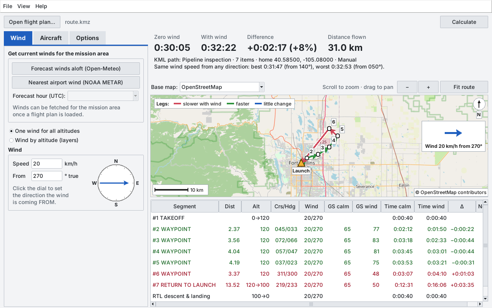

# FlightTime Calc

A desktop app that estimates how long a **fixed-wing** or **VTOL (QuadPlane)** mission will take,
**with zero wind and with the winds you set**, so you can see the effect of the wind before you fly.



* **Open a flight plan**:
  * ArduPilot / Mission Planner waypoint files (`.waypoints`, `.txt`, `.mission`)
  * QGroundControl `.plan` files, including survey patterns
  * Google Earth **KML** and **KMZ** paths, or ordered waypoint placemarks
* **Set the wind**: type a speed and direction, or click the compass dial. You can also enter
  different winds at different heights.
* **Get live winds** for the mission area with one click (free, no account or API key):
  * **Open-Meteo forecast** (worldwide): winds at 10, 80, 120 and 180 m above ground, plus higher
    pressure levels. You can pick any forecast hour from yesterday to two days ahead.
  * **NOAA METAR**: the latest observed surface wind at the nearest airport (best coverage in North America).
* **Results**:
  * Total time with zero wind and with wind, the difference, and the distance flown.
  * Best-case and worst-case times for the same wind speed from any direction.
  * An optional check against the aircraft's endurance.
  * A per-leg table showing course, heading (crab angle), ground speed and time. Export it to CSV.
  * A route map on an open-source base map (**OpenStreetMap** or **OpenTopoMap** terrain). Each leg
    is coloured red if the wind slows it down and green if it speeds it up. Scroll to zoom, drag to pan.
* **Light, dark or system appearance**: choose it on the *Options* tab or the *View* menu. *System*
  follows your computer's light/dark setting, even while the app is open.
* **Readable at any display scaling** (Windows 125–200%, Retina/HiDPI screens): table rows, columns and
  controls are sized from the actual font.
* **Metric units by default** (km/h, metres, km). Knots, mph, m/s and feet can be chosen on the
  *Options* tab.

## Download and run (no install needed)

Standalone builds are made automatically by GitHub Actions for each operating system
(see the **Actions** tab → latest run → *Artifacts*, or the **Releases** page for tagged versions):

| System | File | How to start |
|---|---|---|
| Windows 10/11 | `FlightTimeCalc-windows-x64.exe` | Double-click. If SmartScreen warns, choose *More info → Run anyway*. |
| macOS (Apple Silicon / Intel) | `FlightTimeCalc-macos-*.zip` | Unzip, then right-click `FlightTimeCalc.app` → *Open* the first time (the app is unsigned). |
| Linux x86-64 | `FlightTimeCalc-linux-x86_64` | `chmod +x FlightTimeCalc-linux-x86_64` then run it. |

To make a downloadable release, push a version tag (for example `git tag v1.0.0 && git push --tags`).
The builds are then attached to a GitHub Release automatically. You can also run the
*Build standalone apps* workflow by hand from the **Actions** tab and enter a tag (for example `v1.2.1`)
in *release_tag*; GitHub then creates the tag and the release itself.

## Run from source

You need Python 3.9 or newer with Tkinter. Tkinter is included with the python.org installers on
Windows and macOS. On Linux, install it with `sudo apt install python3-tk` (Debian/Ubuntu) or
`sudo dnf install python3-tkinter` (Fedora). The app itself has no third-party dependencies.

```bash
python run_flighttime.py                         # or: python -m flighttime
python run_flighttime.py mission.waypoints       # open a file straight away
```

### Build a standalone executable yourself

PyInstaller can't cross-compile, so build on the operating system you want to target:

```bash
pip install -r requirements-build.txt
python build.py
```

### Tests

```bash
python -m pytest tests
```

## How the estimate works

The app steps through the mission the way ArduPlane / QuadPlane would fly it:

* **Legs** are flown at the cruise airspeed. The wind triangle is solved for each leg's course, so the
  aircraft crabs into crosswinds and loses or gains ground speed from head- and tailwind components.
  If a *minimum ground speed* is set, airspeed is raised toward *max airspeed* in strong headwinds
  (like `MIN_GROUNDSPD`). A leg the aircraft cannot fly in that wind is flagged as *not flyable*.
* **Climbs and descents** use the climb and descent rates. A leg takes whichever is longer: the
  horizontal part or the vertical part.
* **Commands simulated**: `TAKEOFF`, `WAYPOINT`, `SPLINE_WAYPOINT`, `LOITER_TIME`, `LOITER_TURNS`
  (ground speed is integrated round the circle), `LOITER_TO_ALT`, `LOITER_UNLIM` (the estimate stops
  there), `RETURN_TO_LAUNCH` (at RTL altitude, with landing), `LAND`, `VTOL_TAKEOFF`, `VTOL_LAND`,
  `DELAY`, `DO_JUMP` loops, `DO_CHANGE_SPEED`, `DO_VTOL_TRANSITION`.
* **VTOL**: vertical climb and descent rates, a slower final landing stage, and forward and back
  transition times. Flight in multicopter mode uses the VTOL horizontal speed.
* **Winds by height**: each leg uses the wind interpolated at its mid-point height above launch.
* **KML paths** have no commands, so on the *Options* tab you choose whether to add a take-off and a
  return-to-launch, whether the first point is the launch spot, and the altitude to use if the path
  has none.

Map tiles are cached on your computer for 30 days, so routes you've viewed before still show a map
when you're offline. With no internet connection and no cached tiles, the route is drawn on a plain
background.

Settings (units, aircraft, wind and base map) are remembered between runs. Aircraft profiles can be saved and
loaded as `.json` files for each airframe.

> These are planning estimates. Turns, gusts, turbulence, the autopilot's tuning and battery behaviour
> all affect real flight time, so always keep a healthy reserve.

## Project layout

```
flighttime/
  mission.py    flight plan parsers (waypoints, .plan, KML, KMZ)
  estimator.py  mission simulator / flight-time estimate
  wind.py       wind profile and wind-triangle maths
  weather.py    Open-Meteo and NOAA METAR clients
  basemap.py    OpenStreetMap / OpenTopoMap tile download and cache
  theme.py      light / dark appearance and DPI-aware sizing
  aircraft.py   aircraft performance profiles and presets
  gui.py        Tkinter user interface
examples/       sample missions to try
tests/          unit tests
build.py        PyInstaller build script
```

Weather data: [Open-Meteo.com](https://open-meteo.com) (CC BY 4.0) and
[NOAA Aviation Weather Center](https://aviationweather.gov).
Map data © [OpenStreetMap](https://www.openstreetmap.org/copyright) contributors;
terrain style © [OpenTopoMap](https://opentopomap.org) (CC-BY-SA).
